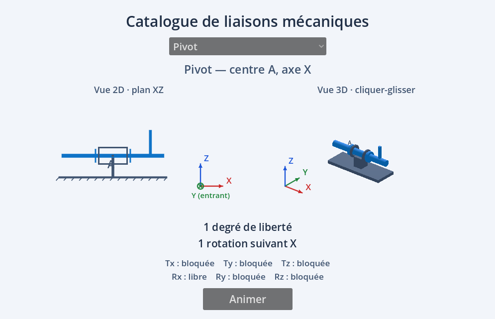

# Catalogue de liaisons mécaniques

Application interactive développée avec **Godot 4.7** pour visualiser les liaisons mécaniques usuelles, leurs degrés de liberté et leur mouvement, en 2D et en 3D.

Développée au sein de l'établissement **Saint Gatien la Salle** à Joué-lès-Tours, dans le cadre des classes de **Première et Terminale SI** (Sciences de l'Ingénieur).

▶️ **Essayer en ligne :** https://charles-sii.github.io/liaison_cinematique_godot/



## Fonctionnalités

- Sélection d'une liaison dans une liste déroulante
- **Vue 2D** schématique (plan XY ou XZ selon la liaison)
- **Vue 3D** orientable au cliquer-glisser
- Tableau des 6 mobilités (Tx, Ty, Tz, Rx, Ry, Rz) : libre ou bloquée
- Bouton **Animer** pour voir le mouvement relatif autorisé
- Option **Isoler Rz** pour comparer l'angle demandé et l'angle obtenu (utile pour la rotule à doigt, où Rz est bloquée)

## Liaisons disponibles

| Liaison | Centre | Géométrie | Degrés de liberté | Mobilités |
|---|---|---|---|---|
| Encastrement | B | fixe | 0 | aucune |
| Pivot | A | axe X | 1 | Rx |
| Glissière | A | axe X | 1 | Tx |
| Hélicoïdale | B | axe X | 1 | Tx et Rx liées (Tx = pas × Rx / 2π) |
| Pivot glissant | C | axe X | 2 | Tx, Rx |
| Rotule à doigt | O | Rz bloquée | 2 | Rx, Ry |
| Rotule / sphérique | O | centre fixe | 3 | Rx, Ry, Rz |
| Appui plan | D | normale Z | 3 | Tx, Ty, Rz |
| Linéaire annulaire | B | axe X | 4 | Tx, Rx, Ry, Rz |
| Linéaire rectiligne | C | axe X, normale Z | 4 | Tx, Ty, Rx, Rz |
| Ponctuelle | O | normale Z | 5 | Tx, Ty, Rx, Ry, Rz |

## Structure du dépôt

```
├── project.godot          # Configuration du projet Godot
├── main.tscn              # Scène principale (interface 2D / 3D)
├── scripts/
│   ├── joint_catalog.gd   # Données des liaisons (mobilités, centre, géométrie)
│   └── pivot_demo.gd      # Affichage, animation et interactions
├── export_presets.cfg     # Preset d'export Web
└── docs/                  # Export HTML5 publié sur GitHub Pages
```

## Ouvrir le projet

1. Installer [Godot 4.7](https://godotengine.org/download) (version standard, pas .NET).
2. Cloner le dépôt :
   ```bash
   git clone https://github.com/Charles-SII/liaison_cinematique_godot.git
   ```
3. Dans Godot : **Importer** → sélectionner `project.godot` → **F5** pour lancer.

## Ajouter une liaison

Chaque liaison est une entrée du tableau `ENTRIES` dans `scripts/joint_catalog.gd` :

```gdscript
{"name": "Pivot", "center": "A", "geometry": "axe X",
 "dof": [0,0,0,1,0,0],   # Tx, Ty, Tz, Rx, Ry, Rz (1 = libre)
 "count": 1, "motion": "1 rotation suivant X"},
```

## Exporter pour le Web

**Projet → Exporter… → Web → Exporter le projet** (le chemin est déjà réglé sur `docs/index.html`), puis commit et push : GitHub Pages se met à jour automatiquement.

> Pour tester l'export en local, passer par un serveur local (ouvrir `index.html` en double-cliquant ne fonctionne pas) :
> ```bash
> python -m http.server 8000 --directory docs
> ```

## Licence

Ce projet est distribué sous licence [Creative Commons Attribution 4.0 International (CC BY 4.0)](https://creativecommons.org/licenses/by/4.0/deed.fr) : vous pouvez le réutiliser, le modifier et le partager, y compris à des fins commerciales, à condition de citer l'auteur. Voir le fichier [LICENSE](LICENSE).

## Auteur

Charles Esnault — Saint Gatien la Salle, Joué-lès-Tours.
